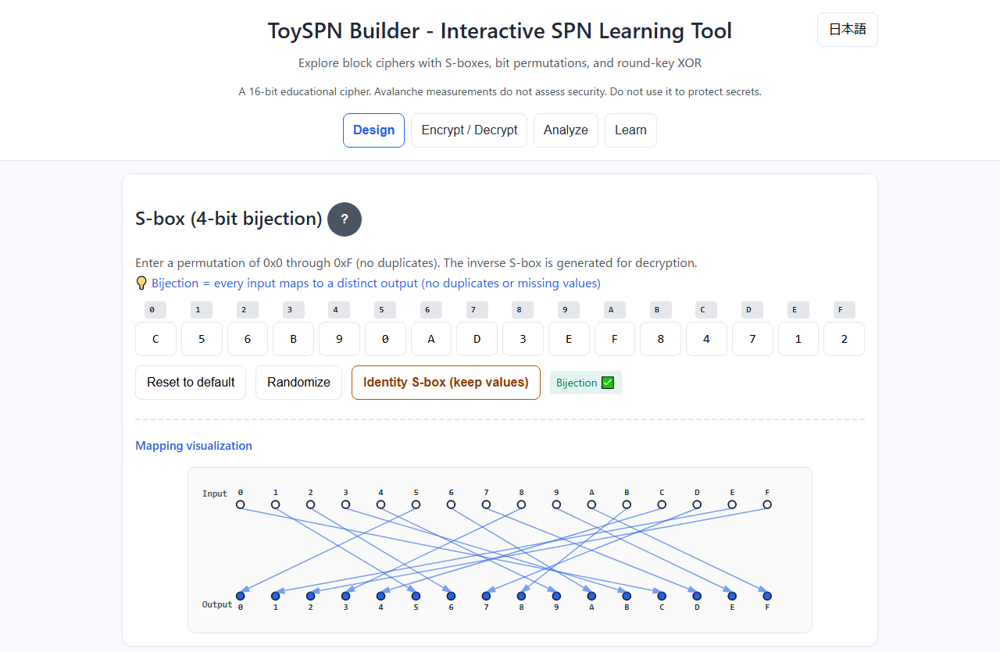
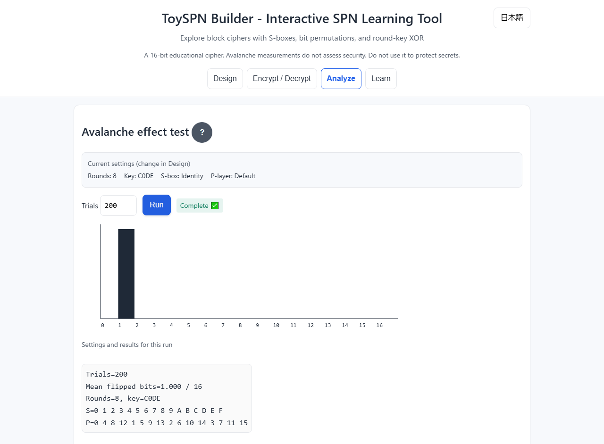
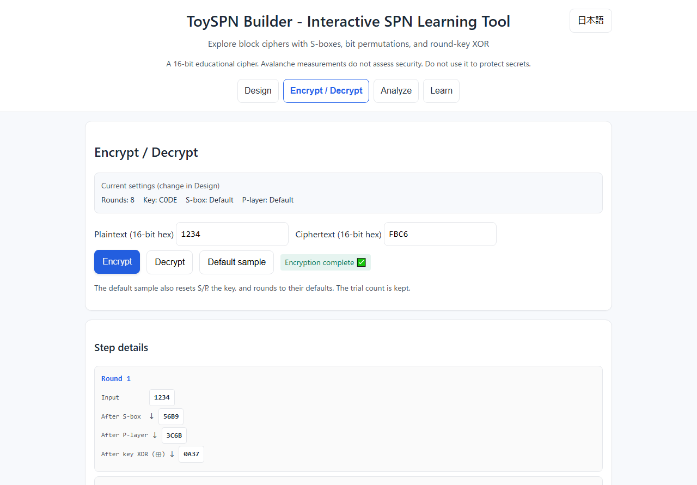

English · [日本語](README.md)

# ToySPN Builder - Interactive SPN Block Cipher Learning Tool


[](https://ipusiron.github.io/toyspn-builder/)

**Day094 - 100 Security Tools with Generative AI**

ToySPN Builder is an educational web tool for designing and running an SPN (Substitution-Permutation Network): value substitution through an S-box, bit rearrangement through a P-layer, and round-key XOR.
Inspect encryption and decryption steps, and observe output changes caused by a one-bit input difference.

It provides a way to compare the Hill cipher's linear transformation with a construction using a nonlinear S-box.
The key and block are only 16 bits. Do not use this tool to protect real secrets.

---

## 🌐 Demo

👉 [Open ToySPN Builder](https://ipusiron.github.io/toyspn-builder/)

Try it directly in your browser.

---

## 📸 Screenshots

>
>*Building an S-box*
>
>
>*An avalanche test with the miniature SPN*
>
>
>*Transforming plaintext 1234 into ciphertext FBC6*

---

## 🚀 Quick start

### Basic usage

1. Select “Encrypt / Decrypt” and press “Default sample.”
   This sets the default S and P, key `C0DE`, 8 rounds, and plaintext `1234`.
2. Press “Encrypt.”
   The ciphertext is `FBC6`, with the intermediate states of all 8 rounds.
3. Without changing the settings, press “Decrypt.”
   Check that the plaintext returns to `1234`.
4. Select “Analyze” and press “Run” with 200 trials.
   Inspect the histogram, table, mean, and recorded settings.
5. Select “Learn” and expand the relevant explanation.

Plaintext, ciphertext, and key accept 1–4 hexadecimal digits.
Uppercase and lowercase are accepted, and leading zeros may be omitted.
Blank input, invalid characters, and out-of-range integers produce errors.

### Experimental usage

- Change one setting at a time: S, P, key, or rounds.
- Use “Identity S-box,” “Identity P-layer,” or “Minimum 1” to simplify an operation.
- Specify an integer from 10 to 2000 for the analysis trial count.

Changing settings clears results derived from those settings.
Plaintext and ciphertext fields are retained, but they are not results computed with the new settings.
“Default sample” resets S, P, key, rounds, and plaintext, and clears ciphertext and results. It keeps the trial count.
The note below the button explains what will change, and a message confirms the loaded values.

“Encrypt / Decrypt” and “Analyze” show the current round count, key, and S/P types.
Each table is labeled Default, Identity, Custom, or Needs correction. Uncommitted input is labeled Composing input.
This display follows the current inputs and is separate from the analysis section labeled “Settings and results for this run.”
Before execution, an instruction explains what to do. After results are invalidated, it asks you to run again.
Running and error states also have their own messages.

Use the button at the top right of the header to switch between Japanese and English.
On narrow screens, it sits above the title on the right, separate from the feature tabs.
The initial language is selected from `?lang=ja|en`, the saved preference, then the browser locale, in that order.
Inputs and results are not saved, and switching language does not rerun analysis.
Switching still works when browser storage is unavailable.

---

## 🎯 Intended users

This tool is intended for:

- Students beginning cryptography
  Learners at universities, technical colleges, or vocational schools who want to run a block cipher and inspect its internal structure.

- Information-security beginners
  Aspiring security engineers who want to understand the basic mechanisms behind modern ciphers such as AES.

- Learners moving from classical to modern cryptography
  People familiar with the Hill or Caesar cipher who want to compare classical and modern cipher structures.

- Cryptography educators
  Teachers and instructors looking for a visual explanation of SPNs and avalanche observations, or a hands-on exercise.

- Programmers and engineers
  Developers who use cryptographic libraries and want to learn about the operations inside them.

- People experimenting with cipher design
  Learners who want to edit S-box and P-layer tables and observe reversibility and output differences.

- Learners connecting mathematics with implementation
  People who know the mathematical theory and want to inspect bit operations and state transitions.

---

## 🌉 From the Hill cipher to ToySPN Builder

### 1️⃣ How the Hill cipher works

The Hill cipher transforms letters using a matrix.
With “A=0, B=1, …, Z=25,” several letters form a vector.

```text
ciphertext = key matrix × plaintext (mod 26)
```

Decryption requires a key matrix that is invertible modulo 26.
Given enough linearly independent plaintext–ciphertext pairs, the key matrix can be recovered by solving simultaneous equations.
Knowing the algorithm alone is not the condition: the number and independence of the available pairs matter.

[Hill CipherLab](https://ipusiron.github.io/hill-cipherlab/) provides exercises in matrix operations and key recovery from known plaintext.
The Hill cipher operates on letters, while this tool operates on bits; their underlying sets and arithmetic differ.

### 2️⃣ Nonlinear transformations in modern ciphers

SPN block ciphers combine transformations with different properties.

1. S-box
   Substitutes values using a table. A nonlinear table introduces a transformation that cannot be expressed by linear relationships alone.
   An arbitrary permutation table is not necessarily nonlinear.
2. P-layer (permutation layer)
   Rearranges bit positions, changing which S-box receives a difference in the next round.
   The P-layer alone does not increase the number of flipped bits.
3. AddRoundKey (key addition)
   XORs the state with a round key. Applying XOR with the same key again restores the original value.
   Decryption uses this reversibility.

This combination alone does not establish security.
S-box properties, key derivation, block size, and key length also require examination.

### 3️⃣ The ToySPN Builder construction

This tool makes the three operations observable on a small block.

1. S-box: substitutes 4-bit values (0–15).
   The default table begins “0→C, 1→5, 2→6…”.
   An identity S-box leaves values unchanged and is not nonlinear.
2. P-layer: rearranges 16 bit positions.
   It is linear over GF(2) and does not change individual bit values.
   The Hill cipher also uses a linear transformation, but not the same arithmetic.
3. AddRoundKey: XORs the state with a key at the end of each round.
   The S-box, P-layer, and key XOR sequence is repeated for the selected number of rounds.
   This is neither an implementation nor a reduced implementation of AES.

### 4️⃣ Differences and connections with the Hill cipher

| Property | Hill cipher | ToySPN Builder |
| --- | --- | --- |
| Transformation | Matrix arithmetic modulo 26 | S-box + P-layer over GF(2) + key XOR |
| Diffusion | Matrix multiplication | S-boxes and bit rearrangement between rounds |
| Key use | Key matrix | Round-key XOR in every round |
| Reversibility | Invertible key matrix | Bijective S and P |
| Practical role | Educational; unsuitable for protecting secrets | 16-bit educational cipher; unsuitable for protecting secrets |

Both require encryption operations that can be reversed for decryption.
Reversibility and resistance to attacks are different properties.

### 5️⃣ Nonlinearity is not a security guarantee

A linear transformation can be recovered as a matrix from enough independent input–output pairs.
A nonlinear S-box introduces a transformation to which that method does not directly apply.
Being expressible as a mathematical formula is not itself a weakness; exploitable linear relationships are the issue.

A bijective S-box does not necessarily provide nonlinearity or resistance to differential cryptanalysis.
This tool does not measure those forms of resistance.
Distinguish observed output differences from cryptographic security when editing the table.

### 6️⃣ Observing the avalanche effect

Flip exactly one input bit and count the Hamming distance between the resulting ciphertexts.
The “Analyze” tab repeats this process with random plaintexts and flipped bit positions.

In a model where each output bit flips with probability 1/2, the mean is 8 bits.
A mean near 8 does not establish individual flip probabilities or independence.
It cannot serve as a pass criterion for SAC (the strict avalanche criterion) or cipher security.

- Changing S or P may change the mean or distribution.
- Adding rounds does not necessarily increase the number of flipped bits.
- Even with identical settings, results vary with the sampled plaintexts and bit positions.

### 7️⃣ Properties to distinguish when learning

- Bijectivity: an inverse transformation can be constructed.
- Nonlinearity: the transformation cannot be expressed by linear relationships alone.
- Avalanche observations: how output differences spread under the chosen conditions.
- Security: an assessment involving resistance to attacks, which these observations alone cannot establish.

Use this tool to study settings and results without treating those four properties as equivalent.

---

## 📚 Learning scenarios

### 🧪 Scenario 1: Trace differences with an identity S-box

Purpose: distinguish value substitution from rearranging bit positions.

Procedure:

1. Run an avalanche test with the default settings and note the result.
2. In “Design,” press “Identity S-box (keep values).”
3. Run the analysis again.
4. Inspect the distribution table and “How to read the results.”

Observable results:

- With a valid P-layer and key, the mean is exactly 1 for every allowed round count from 1 to 16.
- The P-layer moves the difference without multiplying it; fixed-key XOR also preserves the difference count.
- The S-box diagram has vertical lines connecting each input to the identical output.

This property applies to the identity S-box.
It does not mean that every linear S-box produces a mean of 1.

### 🔬 Scenario 2: Investigate rounds and output differences

Purpose: measure what happens when the round count changes.

Procedure:

1. Load the default sample to restore the initial settings, then select 1 round.
2. Run an avalanche test and note the conditions and result.
3. Repeat with 4, 8, and 16 rounds.
4. Compare distributions as well as means.

There is no predefined passing range for any round count.
Separate runs also use different samples, so an observed difference cannot automatically be attributed solely to the round count.

For a counterexample, use S = `[0,E,D,3,B,5,6,8,7,9,A,4,C,2,1,F]` and the default P.
For this linear S-box, averaging all input-bit differences for any input gives means of `3, 9, 3, 1` for rounds 1–4.
Distinguish this exhaustive bit-position average from the UI's finite random sample.
The computation demonstrates that more rounds need not move the mean toward 8.

### 🎨 Scenario 3: Examine reversibility and observations with custom tables

Purpose: check bijectivity separately from features of the measured results.

Procedure:

1. Randomize the S-box and inspect its mapping diagram.
2. Randomize the P-layer.
3. Randomize the master key.
4. Press “Validate settings” to check table bijectivity.
5. Encrypt plaintext `1234`, then decrypt without changing settings.
6. Run an avalanche test and note the conditions and distribution.
7. Change only one setting for the next comparison.

Generated S and P tables are bijective, so decryption works with a valid key and round count.
Random generation does not guarantee nonlinearity or cipher security.
Different S/P combinations producing the same mean need not have the same cryptographic properties.

## 🎯 Use cases

Ways of using this tool in particular:

- Regression checks: developers can check a change against the known round trip `1234 → FBC6 → 1234`. One example cannot establish correctness for every setting.
- Learning about wiring: electronics learners can trace the default P mapping `b1 → b4` as a change in the connections between 16 signal lines. This is not a voltage or propagation-delay simulation.
- Interpreting means: statistics learners can compare the identity S-box mean of `1.000` with its distribution, in which every trial flips one bit. A mean alone cannot reconstruct a general distribution.
- Reverse-operation puzzles: puzzle designers can use the intermediate states from `FBC6` back to `1234`. This is not a secret communication channel or secure authentication mechanism.

General uses:

- Classes and self-study: inspect values at each round to check the order of encryption and decryption operations.
- Work: use out-of-range inputs in training about bit operations and input validation, and explain why they are rejected.
- Home and hobbies: use permutations of 16 values to learn about one-to-one mappings and inverses.
- Research preparation: observe changes to S and P to form hypotheses. Do not substitute this for security proofs or full cryptanalysis.
- Combining tools: compare with Hill CipherLab to distinguish the underlying number systems and conditions for reversibility.

---

## ✨ Features

### 🎨 Design

- S-box design (4-bit bijection)
  - Edit a table of 16 values
  - Generate the inverse S-box when decrypting
  - Randomize the table
  - Observe unchanged values using the identity S-box button
  - Visualize input-to-output mappings with SVG

- P-layer design (16-bit permutation)
  - Edit 16 destination bit positions
  - Generate the inverse permutation when decrypting
  - Randomize the table
  - Keep bit positions unchanged with the identity P-layer button
  - Visualize bit-position mappings with SVG

- Round count
  - Select 1–16 rounds (default: 8)
  - Select the minimum 1 or maximum 16 with one button

- Master key
  - Set a 16-bit key using 1–4 hexadecimal digits
  - Generate a random key

- Settings validation
  - Check S-box and P-layer bijectivity
  - Derive round keys and display the first round key
  - Indicate whether encryption can proceed or settings are invalid

### 🔐 Encryption and decryption

- A 16-bit block cipher (4 nibbles)
- Step-by-step visualization
  - Inspect each round's state transitions
  - See the states after the S-box, P-layer, and key XOR
- A simplified key schedule (left rotation + round-constant XOR)

### 📊 Analysis

- Avalanche effect test
  - Measure the distribution of output differences for a one-bit input difference
  - Calculate the mean number of flipped bits without grading security
  - Display a histogram and data table
  - 💡 How to read the results
    - Record S, P, key, rounds, and trial count
    - Explain observations and measurement limits
    - Give notes on comparing different conditions

### 🎓 Learning

- Expandable explanations
  - SPN fundamentals
  - The role and design of S-boxes
  - The P-layer and diffusion
  - Key schedules
  - The avalanche effect
  - A brief history of block ciphers
  - Limitations and differences from practical ciphers

### 🛡️ Security and quality

- XSS prevention through textContent/createElement rather than innerHTML
- Strict input validation
- Content Security Policy (CSP)
- Meta CSP and referrer control, without claiming defenses requiring HTTP-only headers
- No dependencies: plain HTML/CSS/JS, with offline operation

---

## ⚙️ Mini-SPN algorithm

- The state is 16 bits. Each round applies:
  1. SubNib: apply the S-box to each 4-bit nibble.
  2. PermuteBits: a bijective, linear permutation of bit positions.
  3. AddRoundKey: XOR with the round key.
- Decrypt in reverse order: XOR → InvP → InvS.
- Derive round keys from the 16-bit master key using left rotation and round-constant XOR.

> S is a bijective substitution, P is an invertible permutation matrix, and AddRoundKey is XOR.
> Each operation must be reversible for decryption.

---

## 🔧 Default parameters

- S:
  `S = [C,5,6,B,9,0,A,D,3,E,F,8,4,7,1,2]` (hex)
  Editable in the UI; the inverse is generated when decrypting.
- P:
  `P = [0,4,8,12, 1,5,9,13, 2,6,10,14, 3,7,11,15]` (bit 0..15 → P[i])
- Rounds: 8
- Master key: 16 bits (example: `C0DE`)

---

## ⚠️ Limitations

- The key and block are 16 bits. There are only 65,536 possible keys; do not use this cipher to protect secrets.
- This is a single-block exercise. Modes such as ECB, padding, authentication, and file encryption are not implemented.
- Avalanche results are observations under the selected conditions. SAC, differential resistance, linear resistance, and cipher-strength assessment are not implemented.
- Bijectivity establishes reversibility, not nonlinearity or security.
- More rounds or the use of randomness alone do not make this a practical cipher.
- If Web Crypto is unavailable, random generation and analysis report failure. There is no fallback to a weaker random source.
- Saving, sharing, and exporting settings are not implemented. Only the display language is saved.

For real information protection, use appropriate standard cryptography and vetted implementations.
Browser-level defenses and the security of the educational cipher are separate matters.
See [Security measures and limitations](SECURITY.md) (Japanese).

---

## 👨‍💻 Developer information

See [Technical documentation](TECHNICAL.md) (Japanese) for implementation details, algorithms, and design choices.

Topics include:

- Core algorithms: bit permutation, S-boxes, and the key schedule
- Security implementation: XSS prevention, input validation, and CSP
- Analysis trials, SVG updates, and Canvas rendering
- UI design: immediate validation, result explanations, and language switching
- Mathematical background: reversibility and avalanche models
- Fisher–Yates shuffling and cryptographic randomness

---

## 📁 Directory structure

```text
toyspn-builder/              # Project root
├── .github/                # GitHub settings
│   └── workflows/          # Automated tests
│       └── test.yml        # Node.js 22 checks for pushes and PRs
├── .gitignore             # Git exclusions
├── .nojekyll              # Disable Jekyll processing
├── index.html             # Four-tab UI and CSP
├── style.css              # Mobile-first layout
├── js/                    # Browser-side code
│   ├── core.js            # 16-bit SPN and validation
│   ├── analysis.js        # Avalanche observations and chart
│   ├── messages.js        # JA/EN dictionary and language choice
│   └── ui.js              # Input, result, and tab management
├── test/                  # Node.js standard tests
│   ├── core.test.js       # Known cipher output and exhaustive round trip
│   ├── analysis.test.js   # Observations and random-source errors
│   ├── education.test.js  # Counterexample and educational limits
│   ├── html.test.js       # CSP, IDs, and colors
│   ├── messages.test.js   # Translations and language selection
│   ├── readme.test.js     # Bilingual docs and computed examples
│   └── format.test.js     # Source formatting
├── assets/                # Japanese screenshots
│   ├── screenshot.png     # Design screen
│   ├── screenshot2.png    # Avalanche observations
│   ├── screenshot3.png    # Encryption steps
│   └── en/                # English screenshots
│       ├── screenshot.png  # Design screen
│       ├── screenshot2.png # Avalanche observations
│       └── screenshot3.png # Encryption steps
├── package.json           # Dependency-free test configuration
├── README.md              # Japanese documentation
├── README.en.md           # English documentation
├── TECHNICAL.md            # Implementation and mathematics
├── SECURITY.md             # Defenses and limitations
├── CLAUDE.md               # Development rules
└── LICENSE                # MIT license
```

## 💻 Environment and tests

Use a browser supporting JavaScript, SVG, Canvas, and Web Crypto.
No external libraries, CDN, or build process is required.
Open `index.html` in a downloaded copy of the folder, or serve it over local HTTP.

```sh
python -m http.server 8000 --bind 127.0.0.1
```

Tests use the standard facilities of Node.js 22 or newer. No npm install is required.

```sh
npm test
```

GitHub Actions runs tests on push and pull_request.
For UI changes, also check HTTP and file://, Japanese and English, narrow screens, and keyboard operation in a browser.

---

## 📄 License

MIT License. See [LICENSE](LICENSE) for details.

---

## 🛠️ About this tool

This tool is part of the “100 Security Tools with Generative AI” project.
The project creates and publishes security-related tools over 100 days with assistance from generative AI.

For project details and other tools, visit:

🔗 [100 Security Tools with Generative AI](https://akademeia.info/?page_id=42163)
