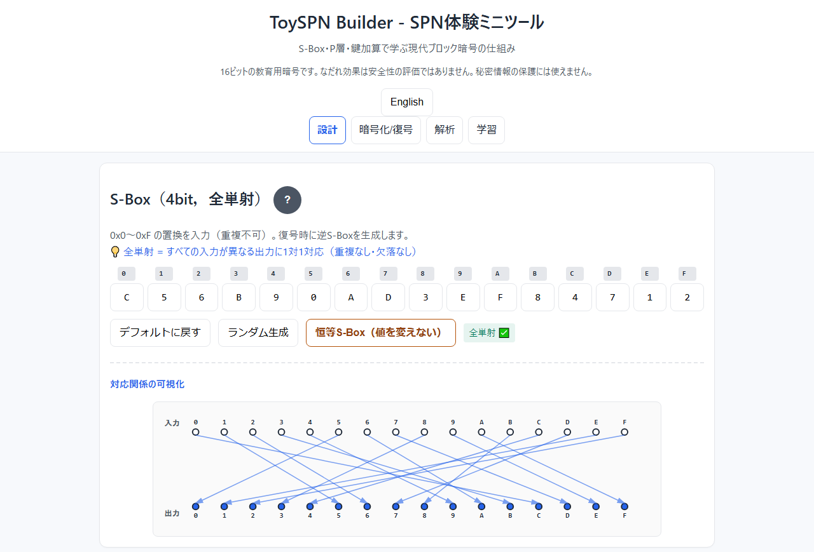
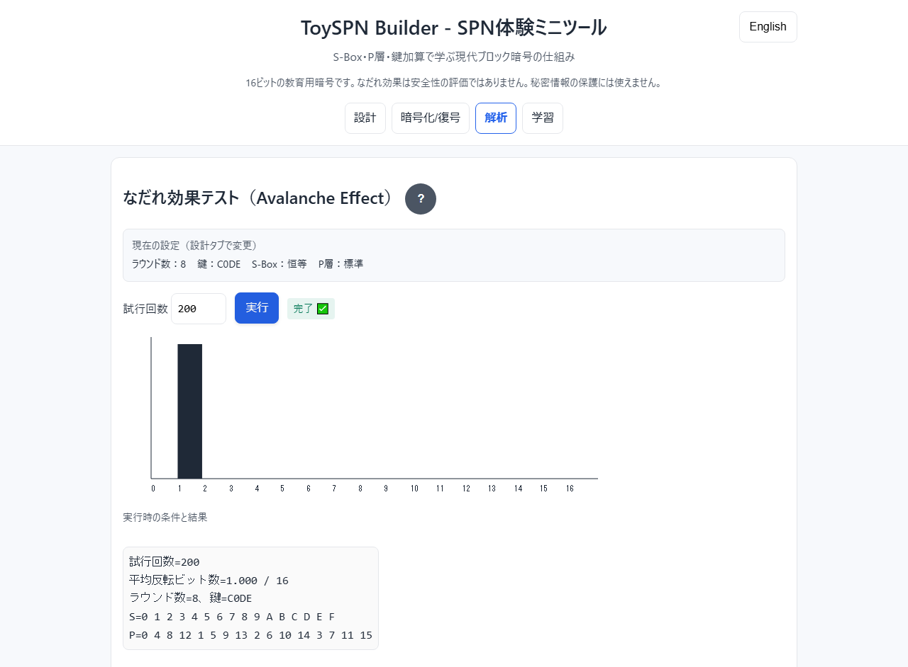
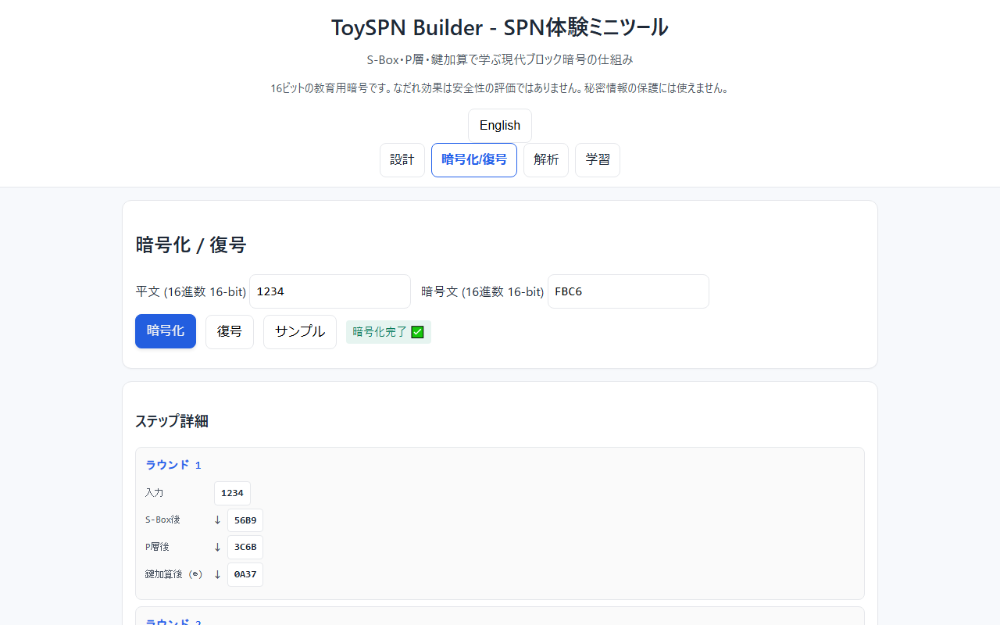

<!--
---
id: day094
slug: toyspn-builder

title: "ToySPN Builder"

subtitle_ja: "SPN体験ミニツール"
subtitle_en: "Interactive SPN Block Cipher Learning Tool"

description_ja: "S-Box・P層・鍵加算からなるSPN（Substitution-Permutation Network）構造を自分で設計・実行し、暗号化ステップの可視化やアバランシェ効果テストで現代ブロック暗号の基礎を体感できる教育用Webツール"
description_en: "An educational web tool to design and run a minimal SPN (Substitution-Permutation Network) block cipher with step-by-step encryption visualization and avalanche effect testing"

category_ja:
  - 現代暗号
  - ブロック暗号
category_en:
  - Modern Cryptography
  - Block Cipher

difficulty: 4

tags:
  - SPN
  - block-cipher
  - S-box
  - permutation
  - avalanche-effect
  - cryptography
  - education
  - javascript

repo_url: "https://github.com/ipusiron/toyspn-builder"
demo_url: "https://ipusiron.github.io/toyspn-builder/"

hub: true
---
-->

[English](README.en.md) · 日本語

# ToySPN Builder - SPN体験ミニツール


[](https://ipusiron.github.io/toyspn-builder/)

**Day094 - 生成AIで作るセキュリティツール100**

ToySPN Builderは、S-Boxによる値の置換、P層によるビットの並べ替え、ラウンド鍵のXORからなるSPN（Substitution-Permutation Network）を設計して動かす教育用Webツールです。
暗号化と復号の途中経過、1ビットの入力差に対する出力変化を観察できます。

ヒル暗号の線形変換と、非線形なS-Boxを使う構成を比べる教材です。
鍵とブロックは16ビットしかありません。実際の秘密情報の保護には使えません。

---

## 🌐 デモページ

👉 [https://ipusiron.github.io/toyspn-builder/](https://ipusiron.github.io/toyspn-builder/)

ブラウザーで直接お試しいただけます。

---

## 📸 スクリーンショット

>
>*S-boxの構築*
>
>
>*ミニSPN構造のなだれ効果テスト*
>
>
>*平文1234から暗号文FBC6への変換*

---

## 🚀 クイックスタート

### 基本的な使い方

1. 「暗号化/復号」タブの「標準サンプル」を押す。
   SとPはデフォルト、鍵は `C0DE`、ラウンド数は8、平文は `1234` になる。
2. 「暗号化」を押す。
   暗号文 `FBC6` と、8ラウンドの途中経過が表示される。
3. 同じ設定のまま「復号」を押す。
   平文が `1234` に戻ることを確認する。
4. 「解析」タブで試行回数200のまま「実行」を押す。
   ヒストグラム、表、平均値と実行条件を確認する。
5. 「学習」タブで、関係する説明を開く。

平文、暗号文、鍵は16進数1〜4桁です。
大文字と小文字を使え、先頭の0は省略できます。
空欄、記号、範囲外の整数などはエラーになります。

### 実験的な使い方

- 設計タブでS、P、鍵、ラウンド数を1項目ずつ変更する。
- 「恒等S-Box」「恒等P層」「最小1」で、操作を単純化して観察する。
- 解析の試行回数は10〜2000の整数で指定する。

設定を変えると、その設定から作られた結果は消えます。
平文と暗号文の入力欄は保持されますが、新しい設定の計算結果ではありません。
「標準サンプル」はS、P、鍵、ラウンド数、平文を初期値に戻し、暗号文と結果を消します。試行回数は保持します。
ボタンの下にも変更する範囲を表示し、読み込み後に設定した値を通知します。

「暗号化/復号」と「解析」には、現在のラウンド数、鍵、S/Pの種類を表示します。
S/Pの種類は標準、恒等、カスタム、要修正のいずれかです。入力が未確定の間は「入力中」と表示します。
この表示は現在の入力に追従し、解析結果の「実行時の条件と結果」とは区別しています。
実行前は操作案内、結果が失効した後は再実行の案内を表示します。解析中とエラー時にも状態を通知します。

ヘッダー右上のボタンで日本語と英語を切り替えられます。
狭い画面ではタイトルより上の右側に配置し、機能を選ぶタブとは分けています。
初期言語は `?lang=ja|en`、保存済みの選択、ブラウザーの言語の順に決まります。
言語以外の入力値や結果は保存せず、言語切替で解析をやり直すこともありません。
保存が禁止されている環境でも切替は利用できます。

---

## 🎯 対象ユーザー

本ツールは以下のような方々に最適です：

- 暗号学を学び始めた学生
  大学・高専・専門学校で暗号理論を学んでいて、ブロック暗号の内部構造を実際に動かして理解したい方

- 情報セキュリティ初学者
  セキュリティエンジニアを目指していて、AESなどの現代暗号がどのような仕組みで動いているか基礎から学びたい方

- 古典暗号から現代暗号への移行を学びたい方
  ヒル暗号やシーザー暗号などの古典暗号を学んだ後、古典暗号と現代暗号の構造の違いを理解したい方

- 暗号学の教育者・講師
  SPN構造やアバランシェ効果を視覚的に説明したい教員・講師の方、実習教材として利用したい方

- プログラマー・エンジニア
  暗号ライブラリを使っているが、内部でどんな処理が行われているか興味がある方

- 暗号アルゴリズムを自作してみたい方
  S-BoxやP層のパラメーターを変えて、自分で表を設計して、可逆性や出力差を観察したい方

- 数学と実装の橋渡しを求めている方
  暗号の数学的理論は学んだが、実際のビット演算や状態遷移を可視化して理解したい方

---

## 🌉 ヒル暗号からToySPN Builderへの橋わたし

### 1️⃣ ヒル暗号の仕組み

ヒル暗号は、行列を使って文字を変換する暗号です。
「A=0, B=1, …, Z=25」として、複数の文字をベクトルにします。

```text
暗号文 = 鍵行列 × 平文（mod 26）
```

復号には、mod 26で逆行列を持つ鍵行列が必要です。
十分な独立した平文と暗号文の組がわかれば、連立方程式から鍵行列を求められます。
仕組みを知っていることだけでなく、攻撃に使える組の数と独立性が条件になります。

[Hill CipherLab](https://ipusiron.github.io/hill-cipherlab/)では、行列演算や既知平文からの鍵回復を学べます。
文字を扱うヒル暗号と、ビットを扱う本ツールでは、計算する集合が異なります。

### 2️⃣ 現代の暗号で使われる非線形変換

SPN型のブロック暗号では、性質の異なる変換を組み合わせます。

1. S-Box（エスボックス）
   入力値を表で置き換える。非線形な表を選ぶと、線形関係だけでは表せない変換になる。
   任意の置換表が非線形とは限らない。
2. P層（Permutation Layer）
   ビット位置を並べ替える。次のラウンドで、どのS-Boxに変化が伝わるかを変える。
   P層だけでは反転ビット数は増えない。
3. AddRoundKey（鍵加算）
   ラウンド鍵をXORする。同じ鍵をもう一度XORすると元に戻る。
   この可逆性を復号に利用する。

この組み合わせだけで安全性は決まりません。
S-Boxの性質、鍵導出、ブロック長、鍵長なども検討対象になります。

### 3️⃣ ToySPN Builderの構成

本ツールは、3つの操作を小さなブロックで観察できます。

1. S-Box：4ビットの値（0〜15）を置き換える。
   デフォルトの表は「0→C、1→5、2→6…」。
   恒等S-Boxでは値を変更しないため、非線形変換にならない。
2. P層：16個のビット位置を並べ替える。
   GF(2)上の線形変換であり、各ビットの値は変えない。
   ヒル暗号も線形変換を使うが、同じ演算ではない。
3. AddRoundKey：各ラウンドの最後に鍵をXORする。
   S-Box、P層、鍵XORを指定回数繰り返す。
   AESそのものの実装や簡略版ではない。

### 4️⃣ ヒル暗号とのちがいとつながり

| 比べる項目 | ヒル暗号 | ToySPN Builder |
| --- | --- | --- |
| 変換の種類 | mod 26の行列計算 | S-Box＋GF(2)上のP層＋鍵XOR |
| 拡散 | 行列の掛け算 | S-Boxとラウンド間のビットの並べ替え |
| 鍵の使い方 | 鍵行列 | 毎ラウンドの鍵をXOR |
| 可逆性 | 鍵行列が可逆 | SとPが全単射 |
| 実用上の位置付け | 学習用であり秘密情報の保護には不適 | 16ビットの学習用であり秘密情報の保護には不適 |

どちらも、暗号化の各操作を逆にたどれることが復号の条件です。
一方、復号できることと、攻撃に強いことは別の性質です。

### 5️⃣ 非線形性と安全性の区別

線形な変換は、十分な独立した入出力がわかると、行列として求められます。
非線形なS-Boxは、その方法をそのまま適用できない変換を導入します。
「数式で書けること」が弱点なのではなく、利用できる線形関係が問題です。

S-Boxが全単射であっても、非線形性や差分解析への耐性は保証されません。
本ツールはこれらの耐性を測定しません。
表を変えたときの出力差と、暗号学的な安全性を区別して観察してください。

### 6️⃣ アバランシェ効果（なだれ効果）の観測

入力の1ビットだけを変え、暗号文どうしのハミング距離を数えます。
「解析」タブでは、ランダムな平文と反転位置で繰り返した結果を表示します。

各出力ビットが確率1/2で反転するモデルでは、平均は8ビットです。
ただし、平均が8に近いだけでは、各ビットの反転確率や独立性はわかりません。
SAC（厳密ななだれ基準）や暗号の安全性の合格判定には使えません。

- SやPを変えると、平均や分布が変わる場合がある。
- ラウンドを増やしても、反転ビット数が増えるとは限らない。
- 同じ設定でも、抽出する平文と反転位置により測定結果は変わる。

### 7️⃣ 学習で区別する性質

- 全単射：逆の変換を作れること。
- 非線形性：線形な関係だけでは表せないこと。
- なだれ効果の観測：選んだ条件で出力差がどの程度広がるか。
- 安全性：特定の攻撃に対する評価を含む、観測値だけでは判断できない性質。

本ツールでは、この4つを同じ意味で扱わず、設定と結果の関係を学びます。

---

## 📚 本ツールの活用シナリオ

### 🧪 シナリオ1：恒等S-Boxで差の伝わり方を調べる

目的：値の置換と、ビット位置の並べ替えを区別すること。

手順：

1. デフォルト設定でなだれ効果テストを実行し、結果をメモする。
2. 設計タブの「恒等S-Box（値を変えない）」を押す。
3. 解析タブで再実行する。
4. 分布表と「結果の読み方」を確認する。

確認できる結果：

- 有効なP層と鍵なら、1〜16ラウンドのどの場合も平均反転ビット数は正確に1。
- P層は差の位置を変えるだけで、固定鍵のXORも差の数を変えない。
- S-Boxの図は入力と同じ出力へ結ぶ垂直線になる。

これは、恒等S-Boxに対する性質です。
一般の線形S-Boxがすべて平均1になるという意味ではありません。

### 🔬 シナリオ2：ラウンド数と出力差の関係を調べる

目的：ラウンド数を増やす効果を、測定によって確認すること。

手順：

1. 標準サンプルで初期設定に戻し、ラウンド数を1にする。
2. なだれ効果テストを実行して、条件と結果をメモする。
3. ラウンド数を4、8、16に変え、それぞれ実行する。
4. 平均だけでなく分布も比較する。

各ラウンド数の測定値には決められた合格範囲はありません。
異なる試行では標本も変わるため、差をそのままラウンド数だけの効果とは解釈できません。

反例を調べるには、Sを `[0,E,D,3,B,5,6,8,7,9,A,4,C,2,1,F]`、Pをデフォルトにします。
この線形S-Boxでは、すべての入力について各ビット差を平均すると、1〜4ラウンドの平均は `3, 9, 3, 1` です。
UIの有限回のランダム試行とは区別してください。
回数が増えるほど平均が8へ近づくとは限らないことを、計算で確認できます。

### 🎨 シナリオ3：独自の表で可逆性と観測値を調べる

目的：全単射の成立と、測定結果の特徴を別々に確認すること。

手順：

1. S-Boxの「ランダム生成」を押して、対応関係の図を見る。
2. P層もランダム生成する。
3. マスター鍵もランダム生成する。
4. 「設定を検証」で表の全単射性を確認する。
5. 平文 `1234` を暗号化し、同じ設定のまま復号する。
6. なだれ効果テストを実行し、条件と分布をメモする。
7. 次は1項目だけ変えて比較する。

生成されたSとPは全単射なので、有効な鍵とラウンド数のもとで復号できます。
ただし、ランダム生成は非線形性や暗号の安全性を保証しません。
異なるSとPの組み合わせが同じ平均値を示しても、同じ暗号学的性質とは限りません。

## 🎯 ユースケース

このツールならではの使い方：

- ソフトウェアの回帰確認：開発者が `1234 → FBC6 → 1234` の既知の往復結果で変更を確認する。1例だけで全設定の正しさは保証できない。
- 配線の学習：電子工作の学習者がデフォルトPの `b1 → b4` を、16本の信号線の接続変更として追う。電圧や伝送遅延のシミュレーションではない。
- 平均値の読み方：統計の学習者が恒等S-Boxの平均 `1.000` と、全試行が1ビットに集まる分布を比べる。平均値だけでは一般の分布を再現できない。
- 逆手順のパズル：制作者が `FBC6` から `1234` に戻す途中状態を問題にする。秘密の連絡手段や安全な認証としては利用できない。

一般的な活用：

- 授業と自習：暗号化と復号の操作順を、各ラウンドの値で確認する。
- 仕事：ビット操作や入力検証を学ぶ社内研修で、範囲外の値が拒否される理由を説明する。
- 家庭と趣味：16個の値の並べ替えを題材に、1対1対応と逆写像を学ぶ。
- 研究の準備：仮説を作るためにSとPの変更を観察する。安全性の証明や本格的な暗号解析の代わりにはしない。
- 他ツールとの組み合わせ：Hill CipherLabの行列演算と比べ、扱う数の集合と可逆性の条件を整理する。

---

## ✨ 本ツールの機能

### 🎨 設計機能
- S-Box設計（4bit, 全単射）
  - 16要素の置換表を自由に編集
  - 復号時に逆S-Boxを生成
  - ランダム生成ボタン
  - 恒等S-Boxボタンで値を変更しない状態を観察
  - 入力→出力の対応関係をSVGで可視化

- P層設計（16ビット置換）
  - 16個のビット位置を自由に編集
  - 復号時に逆置換を生成
  - ランダム生成ボタン
  - 恒等P層ボタンでビット位置を変更しない状態を観察
  - ビット位置の対応関係をSVGで可視化

- ラウンド数設定
  - 1〜16ラウンドまで設定可能（デフォルト: 8）
  - ワンクリックで最小1・最大16に変更可能

- マスター鍵設定
  - 16ビット（16進数1〜4桁）の鍵を設定
  - ランダム生成ボタン

- 設定検証機能
  - S-Box/P層の全単射性チェック
  - ラウンド鍵の自動生成と第1ラウンド鍵の表示
  - 総合判定（暗号化可能/設定エラー）

### 🔐 暗号化/復号機能
- 16-bitブロック暗号（4ニブル）
- ステップバイステップ可視化
  - 各ラウンドの状態遷移を詳細表示
  - S-Box適用後 → P層適用後 → 鍵加算後の各段階を確認可能
- 簡易鍵スケジュール（左回転 + ラウンド定数XOR）

### 📊 解析機能
- なだれ効果テスト（Avalanche Effect）
  - 1ビット入力差で出力変化ビット数の分布を測定
  - 平均反転ビット数の計算（安全性の採点はしない）
  - ヒストグラム可視化（キャンバス + データテーブル）
  - 💡 結果の読み方
    - 実行したS、P、鍵、ラウンド数、試行回数
    - 観測値と測定の限界
    - 条件を変えて比較するときの注意

### 🎓 学習機能
- アコーディオン式の座学コンテンツ
  - SPN構造の基礎
  - S-Boxの役割と設計原理
  - P層の拡散メカニズム
  - 鍵スケジュール
  - なだれ効果（アバランシェ効果）の詳細
  - ブロック暗号の歴史
  - 本ツールの限界と実用暗号との違い

### 🛡️ セキュリティ・品質
- XSS対策（innerHTML不使用、textContent/createElement使用）
- 厳格な入力バリデーション
- Content Security Policy (CSP)
- meta CSPとreferrer制御（HTTP専用ヘッダーによる防御は含まない）
- 依存なし（純HTML/CSS/JS）、オフライン動作可能

---

## ⚙️ ミニSPNのアルゴリズム

- 状態は 16-bit。毎ラウンド：
  1. SubNib：各4-bitニブルに S-Box を適用
  2. PermuteBits：ビット位置の全単射置換（線形）
  3. AddRoundKey：ラウンド鍵と XOR
- 復号は逆順で XOR → InvP → InvS
- 鍵スケジュールは 16-bit master key を 左回転＋ラウンド定数XOR で生成

> S は置換（全単射）、P は置換行列（可逆）、AddRoundKey は XOR。
> いずれも 可逆 であることが復号の必要条件です。

---

## 🔧 デフォルトパラメーター

- S:
  `S = [C,5,6,B,9,0,A,D,3,E,F,8,4,7,1,2]`（16進）
  ※ UIで編集可能。逆写像は復号時に生成。
- P:
  `P = [0,4,8,12, 1,5,9,13, 2,6,10,14, 3,7,11,15]`（bit 0..15 → P[i]へ）
- Rounds: 8
- Master Key: 16bit（例: `C0DE`）

---

## ⚠️ 制限事項

- 鍵とブロックは16ビット。鍵は65,536通りしかなく、秘密情報の保護には使用不可。
- 単一ブロックの教材。ECBなどの暗号利用モード、パディング、認証、ファイル暗号化は未実装。
- なだれ効果は選んだ条件での観測。SAC、差分耐性、線形耐性、暗号強度の判定は未実装。
- 全単射は可逆性の条件。非線形性や安全性を保証する条件ではない。
- ラウンド増加や乱数の使用だけで、実用的な暗号にはならない。
- Web Cryptoを利用できない場合、ランダム生成と解析は失敗を通知。弱い乱数への代替は行わない。
- 設定の保存、共有、エクスポートは未実装。保存するのは表示言語だけ。

実際の情報保護には、用途に適した標準暗号と検証された実装を利用してください。
ブラウザー上の対策と、教材としての暗号の安全性は別です。
[セキュリティ対策と限界](SECURITY.md)も参照してください。

---

## 👨‍💻 開発者向け情報

本ツールの技術的な実装の詳細、アルゴリズム、設計上の工夫については、以下のドキュメントを参照してください：

📖 [技術仕様書（TECHNICAL.md）](TECHNICAL.md)

主な内容:
- コアアルゴリズムの実装詳細（ビット置換、S-Box、鍵スケジュール）
- セキュリティ実装（XSS対策、入力バリデーション、CSP）
- 解析の試行処理、SVGの再描画とCanvasの表示
- UI/UX設計の工夫（リアルタイム検証、結果の説明、日英切替）
- 数学的背景（可逆性の証明、アバランシェ効果の理論）
- Fisher-Yatesシャッフル、暗号学的乱数生成

---

## 📁 ディレクトリー構造

```text
toyspn-builder/              # プロジェクトルート
├── .github/                # GitHub設定
│   └── workflows/          # 自動テスト
│       └── test.yml        # Node.js 22でpushとPRを検証
├── .gitignore             # Git管理対象の除外
├── .nojekyll              # Jekyll処理の無効化
├── index.html             # 4タブの画面とCSP
├── style.css              # モバイルからのレイアウト
├── js/                    # ブラウザーで動く処理
│   ├── core.js            # 16ビットSPNと入力検証
│   ├── analysis.js        # なだれ効果の観測と描画
│   ├── messages.js        # 日英辞書と言語選択
│   └── ui.js              # 入力、結果、タブの管理
├── test/                  # Node.js標準テスト
│   ├── core.test.js       # 既知の暗号出力と全平文往復
│   ├── analysis.test.js   # 観測値と乱数エラー
│   ├── education.test.js  # 説明の反例と限界
│   ├── html.test.js       # CSP、ID、配色
│   ├── messages.test.js   # 翻訳と言語選択
│   ├── readme.test.js     # 日英文書と例の整合
│   └── format.test.js     # ファイルの整形
├── assets/                # 日本語の画面画像
│   ├── screenshot.png     # 設計画面
│   ├── screenshot2.png    # なだれ効果の観測
│   ├── screenshot3.png    # 暗号化の途中経過
│   └── en/                # 英語の画面画像
│       ├── screenshot.png  # 設計画面
│       ├── screenshot2.png # なだれ効果の観測
│       └── screenshot3.png # 暗号化の途中経過
├── package.json           # 依存なしのテスト実行設定
├── README.md              # 日本語の説明
├── README.en.md           # 英語の説明
├── TECHNICAL.md            # 実装と数学の説明
├── SECURITY.md             # 対策と限界
├── CLAUDE.md               # 開発作業の規則
└── LICENSE                # MITライセンス
```

## 💻 動作環境とテスト

JavaScript、SVG、Canvas、Web Cryptoに対応したブラウザーを使用してください。
外部ライブラリー、CDN、ビルド処理は不要です。
ダウンロードしたフォルダーの `index.html` を開くか、ローカルHTTPサーバーで利用できます。

```sh
python -m http.server 8000 --bind 127.0.0.1
```

テストはNode.js 22以降の標準機能で実行します。npm installは不要です。

```sh
npm test
```

GitHub Actionsでもpushとpull_request時に実行します。
単体テストに加え、画面変更時はHTTPとfile://、日本語と英語、狭い画面、キーボード操作をブラウザーで確認してください。

---

## 📄 ライセンス

MIT License – 詳細は [LICENSE](LICENSE) を参照してください。

---

## 🛠️ このツールについて

本ツールは、「生成AIで作るセキュリティツール100」プロジェクトの一環として開発されました。
このプロジェクトでは、AIの支援を活用しながら、セキュリティに関連するさまざまなツールを100日間にわたり制作・公開していく取り組みを行っています。

プロジェクトの詳細や他のツールについては、以下のページをご覧ください。

🔗 [https://akademeia.info/?page_id=42163](https://akademeia.info/?page_id=42163)
